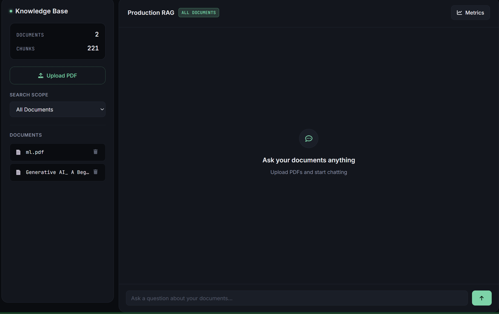
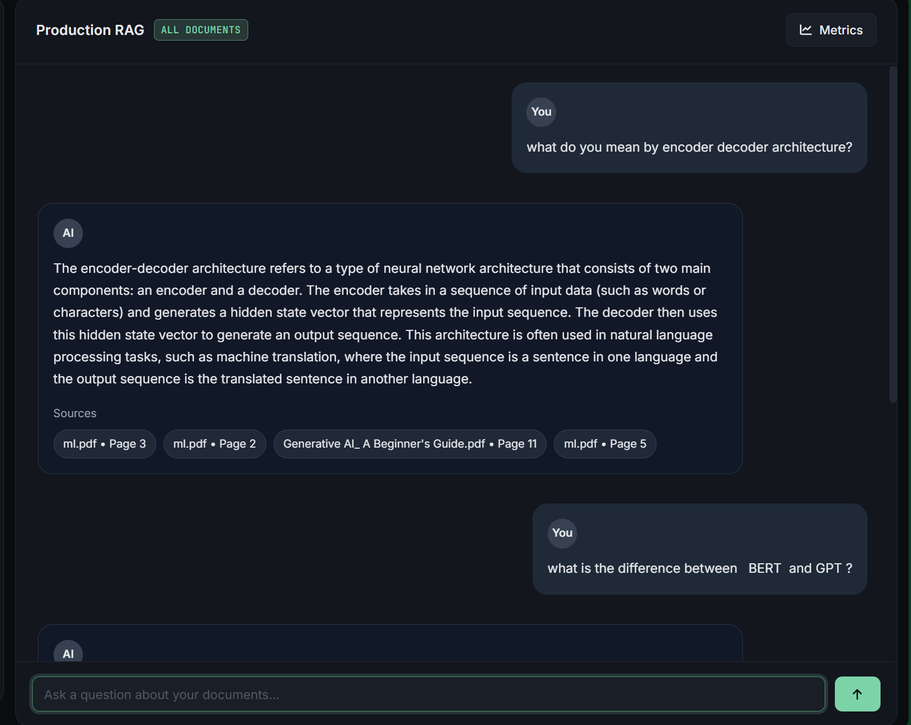
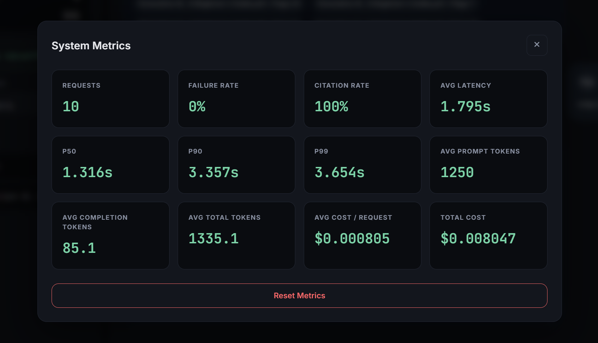
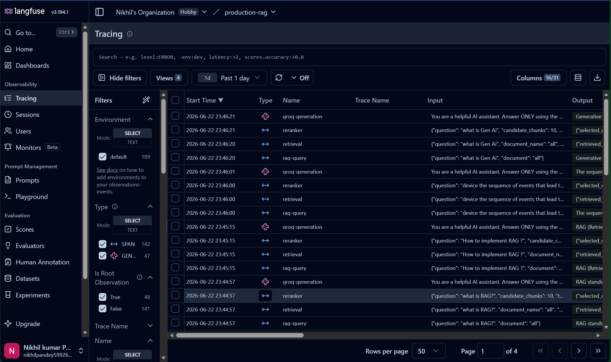

# 🚀DocKeet


A production-oriented Retrieval-Augmented Generation (RAG) system built with FastAPI, React, ChromaDB, Groq, Hybrid Retrieval, Cross-Encoder Reranking, Langfuse Observability, and a custom Metrics Dashboard.

Unlike a basic RAG chatbot, this project focuses on production engineering concepts such as retrieval quality, reranking, observability, latency monitoring, token tracking, cost tracking, and system reliability.

---

# Features

## Document Processing

* Upload PDF documents
* Automatic text extraction
* Recursive text chunking
* Embedding generation
* ChromaDB vector storage

## Retrieval Pipeline

* Dense Vector Search
* BM25 Keyword Search
* Hybrid Retrieval
* Cross-Encoder Reranking
* Top-K Context Selection

## Answer Generation

* Groq Llama 3.3 70B
* Context-grounded answers
* Multi-document querying
* Source citations

## Observability

* Langfuse tracing
* Retrieval tracing
* Reranker tracing
* Generation tracing
* Token usage monitoring

## Metrics Dashboard

* Request count
* Failure rate
* Citation rate
* Average latency
* P50 latency
* P90 latency
* P99 latency
* Average token usage
* Cost per request
* Total accumulated cost

---

# Architecture

```text
                        ┌─────────────────┐
                        │   React Frontend │
                        └────────┬────────┘
                                 │
                                 ▼
                        ┌─────────────────┐
                        │ FastAPI Backend │
                        └────────┬────────┘
                                 │
                ┌────────────────┴────────────────┐
                │                                 │
                ▼                                 ▼

        ┌───────────────┐               ┌─────────────────┐
        │ Vector Search │               │   BM25 Search   │
        │   ChromaDB    │               │ Keyword Search  │
        └───────┬───────┘               └────────┬────────┘
                │                                │
                └──────────────┬─────────────────┘
                               ▼

                     ┌─────────────────┐
                     │ Hybrid Retrieval│
                     └────────┬────────┘
                              ▼

                     ┌─────────────────┐
                     │ Cross Encoder   │
                     │    Reranker     │
                     └────────┬────────┘
                              ▼

                     ┌─────────────────┐
                     │ Context Builder │
                     └────────┬────────┘
                              ▼

                     ┌─────────────────┐
                     │   Groq LLM      │
                     │ Llama 3.3 70B   │
                     └────────┬────────┘
                              ▼

                     ┌─────────────────┐
                     │ Final Answer +  │
                     │ Source Citation │
                     └────────┬────────┘
                              │
            ┌─────────────────┴─────────────────┐
            │                                   │
            ▼                                   ▼

   ┌───────────────────┐             ┌───────────────────┐
   │ Langfuse Tracing  │             │ Metrics Dashboard │
   │ Retrieval Trace   │             │ Latency           │
   │ Reranker Trace    │             │ Cost Tracking     │
   │ Generation Trace  │             │ Citation Rate     │
   └───────────────────┘             └───────────────────┘
```

---

# Screenshots

## Home Screen



---

## Question Answering



---

## Metrics Dashboard



---

## Langfuse Observability



---

# Tech Stack

## Backend

* FastAPI
* ChromaDB
* Sentence Transformers
* BM25 Retrieval
* Cross Encoder Reranker
* Groq API
* Langfuse
* SQLite

## Frontend

* React
* Axios
* React Icons
* Vite
* Custom CSS

---

# Project Structure

```text
production-rag/

├── backend/
│   ├── core/
│   ├── database/
│   ├── ingestion/
│   ├── llm/
│   ├── retrieval/
│   ├── services/
│   ├── metrics/
│   ├── observability/
│   └── app.py
│
├── frontend/
│   ├── src/
│   │   ├── components/
│   │   ├── services/
│   │   ├── App.jsx
│   │   └── index.css
│   │
│   ├── public/
│   └── package.json
│
├── tests/
│   ├── test_rag.py
│   ├── test_retrieval.py
│   ├── test_reranker.py
│   └── ...
│
├── screenshots/
│   ├── home.png
│   ├── qa.png
│   ├── metrics.png
│   └── langfuse.png
│
├── requirements.txt
├── README.md
└── .env
```

---

# Installation

## Clone Repository

```bash
git clone <repository-url>
cd production-rag
```

## Create Virtual Environment

```bash
python -m venv venv
```

## Activate Environment

### Windows

```bash
venv\Scripts\activate
```

### Linux / Mac

```bash
source venv/bin/activate
```

## Install Dependencies

```bash
pip install -r requirements.txt
```

---

# Environment Variables

Create a `.env` file:

```env
GROQ_API_KEY=your_groq_api_key

LANGFUSE_PUBLIC_KEY=your_public_key

LANGFUSE_SECRET_KEY=your_secret_key

LANGFUSE_HOST=https://cloud.langfuse.com
```

---

# Running the Backend

```bash
uvicorn backend.app:app --reload
```

Backend runs on:

```text
http://127.0.0.1:8000
```

---

# Running the Frontend

```bash
cd frontend

npm install

npm run dev
```

Frontend runs on:

```text
http://localhost:5173
```

---

# API Endpoints

## Upload PDF

```http
POST /upload-pdf
```

## Ask Question

```http
POST /ask
```

## List Documents

```http
GET /documents
```

## Metrics

```http
GET /metrics
```

## Reset Metrics

```http
DELETE /metrics/reset
```

---

# Example Response

```json
{
  "answer": "RAG stands for Retrieval-Augmented Generation...",
  "sources": [
    {
      "document": "Generative_AI.pdf",
      "page": 12
    }
  ]
}
```

---

# Metrics Tracked

### Reliability

* Request Count
* Failure Rate
* Citation Rate

### Performance

* Average Latency
* P50 Latency
* P90 Latency
* P99 Latency

### LLM Usage

* Prompt Tokens
* Completion Tokens
* Total Tokens

### Cost Monitoring

* Cost Per Request
* Total Cost

---

# Testing

Example tests:

```bash
python tests/test_rag.py

python tests/test_retrieval.py

python tests/test_reranker.py
```

---

# Future Improvements (Phase 3)

Planned evaluation layer:

* Faithfulness Evaluation
* Answer Relevancy Evaluation
* Context Precision
* Context Recall
* Prompt Versioning
* Regression Testing
* Automated Quality Gates
* Dataset-based Evaluation Pipeline

---

# Learning Outcomes

This project demonstrates:

* Production RAG Architecture
* Hybrid Retrieval Systems
* Cross Encoder Reranking
* LLM Integration
* Observability Engineering
* Cost Monitoring
* Latency Monitoring
* API Development
* Full Stack AI Application Development

---

# Author

**Nikhil Kumar Pandey**

Built as a production-focused RAG system to explore retrieval engineering, reranking, observability, evaluation, and monitoring practices for modern LLM applications.
